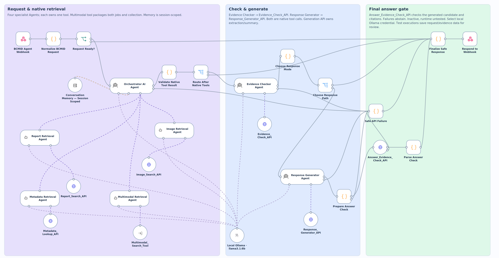
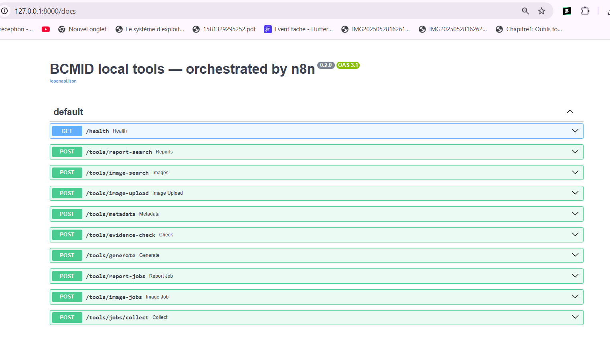
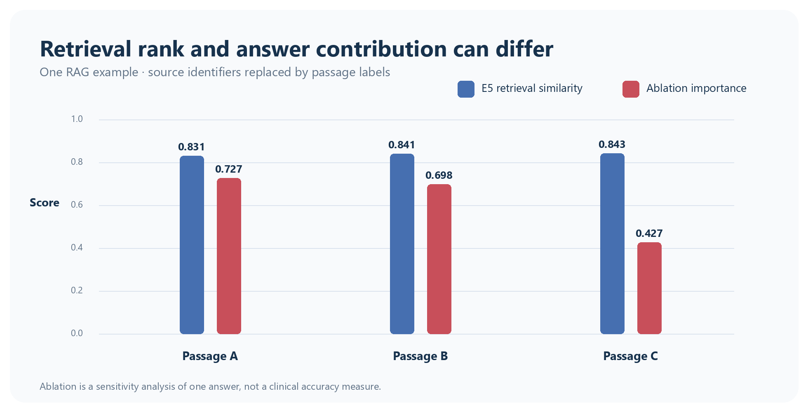
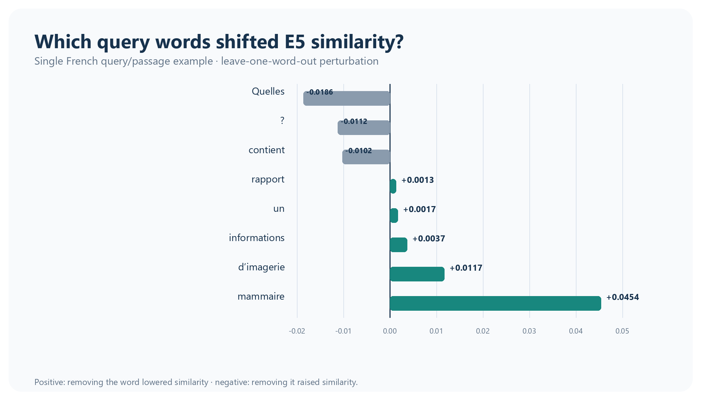
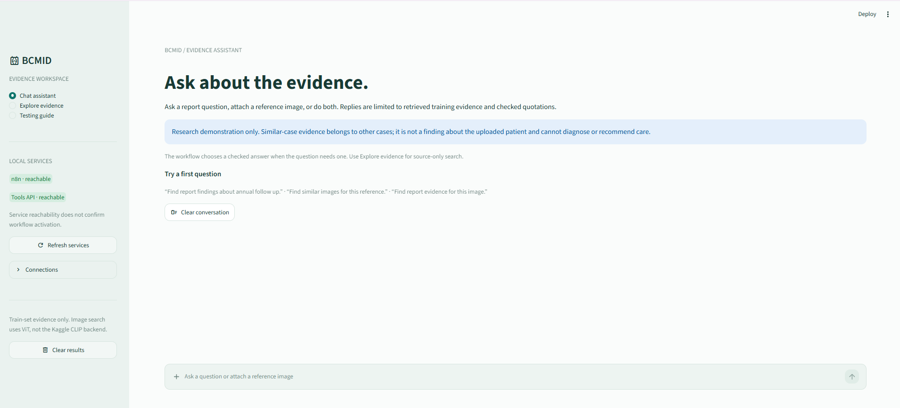

# BCMID · Evidence-first breast imaging research

### Search the record. See the source. Keep the answer in bounds.

BCMID is a local research demo for exploring breast-imaging reports, similar training images, and patient metadata. It brings a Streamlit interface, n8n orchestration, and FastAPI retrieval tools into one traceable workflow.

<p align="center">
  
</p>

<p align="center"><em>Canvas snapshot supplied for project documentation. It describes workflow structure; its visible note marks the depicted candidate inactive and runtime untested.</em></p>

> **Research demonstration only.** Similar cases belong to their own records. They are not findings about an uploaded image or patient. BCMID does not diagnose, assign BI-RADS, or recommend care.

## Two ways to explore

The Streamlit app keeps the conversational assistant and source-search workspace on separate n8n routes:

| Streamlit page | Configured webhook | Purpose |
| --- | --- | --- |
| **Chat assistant** | `POST /webhook/bcmid-seven-native-agents-5a4b5466e029` | Agentic chat route for report, image, combined, and metadata requests |
| **Explore evidence** | `POST /webhook/bcmid-agent` | Normal evidence-search route for report passages, image matches, combined search, and metadata |

These paths are configured in [`.env.example`](.env.example). The app’s local `.env` can override them. A configured URL does not prove that a workflow is currently active; check the local n8n editor and its saved executions before describing runtime behavior.

## Inside the seven-agent canvas

The supplied n8n snapshot lays out three readable lanes: retrieval, evidence and response work, then the final answer gate. It shows the Orchestrator, six specialist roles, a shared local chat model, and session-scoped memory. Dashed links represent the canvas’s AI-tool and model connections.

| Agent | Role | Connected capability shown in the canvas |
| --- | --- | --- |
| **Orchestrator** | Selects the relevant route and coordinates the request | Local Ollama model, specialist agents, session memory |
| **Report Retrieval** | Finds passages related to a report question | `POST /tools/report-search` |
| **Image Retrieval** | Finds visually similar training examples | `POST /tools/image-search` |
| **Metadata Retrieval** | Looks up a patient’s catalog fields | `POST /tools/metadata` |
| **Multimodal Retrieval** | Pairs report and image retrieval jobs | `POST /tools/report-jobs`, `/tools/image-jobs`, `/tools/jobs/collect` |
| **Evidence Checker** | Checks evidence sufficiency and provenance | `POST /tools/evidence-check` |
| **Response Generator** | Produces supported extracts or a summary candidate | `POST /tools/generate` |

The final `Answer_Evidence_Check_API` remains a separate answer and citation gate. A candidate answer is released only when the returned checks accept it; otherwise the workflow should abstain. The screenshot is a canvas view, not an execution trace, so native tool calls and end-to-end behavior must be confirmed from saved n8n executions.


## FastAPI endpoint reference

The screenshot shows the local FastAPI `/docs` page and the feature-tool routes exposed to n8n. It is an API reference snapshot, not proof that every endpoint was called in a workflow execution.

<p align="center"></p>

| Method | Route | Purpose |
| --- | --- | --- |
| `GET` | `/health` | Service health |
| `POST` | `/tools/report-search` | Search report passages |
| `POST` | `/tools/image-search` | Find visually similar training images |
| `POST` | `/tools/image-upload` | Accept an image upload for local image search |
| `POST` | `/tools/metadata` | Look up catalog metadata |
| `POST` | `/tools/evidence-check` | Check evidence sufficiency and provenance |
| `POST` | `/tools/generate` | Generate a response from supplied evidence |
| `POST` | `/tools/report-jobs` | Start a report retrieval job |
| `POST` | `/tools/image-jobs` | Start an image retrieval job |
| `POST` | `/tools/jobs/collect` | Collect job results |

## Final notebook, report, and explainability

The final project notebook and technical report are included for review:

- [Final BCMID notebook](notebooks/BCMID_Final_Project.ipynb) — the 160-cell Kaggle workflow covering dataset checks, patient-level preparation, report extraction, E5/Chroma retrieval, image features, answer generation, evaluation, the agent design, and XAI experiments. This public copy has saved outputs removed and the small embedded test fixtures use synthetic patient labels; run it in the configured Kaggle environment with access to the BCMID dataset and model inputs.
- [Final technical report — public copy](docs/BCMID_Technical_Report_Public.pdf) — the completed report. The XAI example source IDs and identifiable example ultrasound were removed from this copy; the original local report is unchanged. See [public-copy notes](docs/public-report-notes.md) for the specific redactions.

### Project contributions

- A patient-level data preparation path with duplicate checks and explicit train/test separation.
- Structured report extraction and passage indexing with multilingual E5 embeddings and ChromaDB.
- A separate visual-similarity path for finding training examples, with source metadata kept alongside each match.
- Local answer generation bounded by retrieved report evidence, source citations, and an answer-checking step.
- A visible n8n orchestration design that separates specialist retrieval and validation roles from FastAPI feature tools.

These are project capabilities and design goals; the canvas screenshot does not by itself prove a live n8n execution or clinical performance.

### Explainability experiments

The notebook contains three perturbation-based investigations. The public figures below show the two text/RAG experiments with passage labels anonymized:

**RAG passage ablation.** The experiment removes one retrieved passage at a time and compares the change in the generated response/citations with the retrieval similarity. In this single example, the highest similarity score does not correspond to the passage with the greatest ablation importance. Retrieval similarity is useful for ranking; it is not a measure of how much a source supports an answer.

<p align="center"></p>

**E5 word ablation.** The experiment removes one word from a French query and measures the resulting change in cosine similarity to one passage. Positive values mean similarity fell after removing that term; negative values mean it rose. This is a local sensitivity example, not a general linguistic or clinical explanation.

<p align="center"></p>

**Image-search XAI.** The notebook also explores ViT attention and image-region occlusion maps for a CLIP-based image search. The report’s example medical image is omitted from the public copy. These maps describe model sensitivity to image regions and artifacts; they do not explain a diagnosis, establish clinical validity, or mean the chat model interpreted the uploaded image.

All three analyses are exploratory and based on limited examples. They do not establish clinical accuracy or replace expert review.


## Streamlit interface

The screenshot below shows the BCMID Chat Assistant landing view, including the separate evidence workspace, local service indicators, and research-use boundaries.

<p align="center"></p>

## What the interface shows

- **Report search:** a concise result message followed by the ranked report passages and their source references.
- **Image search:** previews of similar training images with rank, patient, split, modality, and source path.
- **Metadata lookup:** a patient card with image and report lists. Locally available PNGs and PDF pages preview inline, with downloads for the original files.
- **Checked response:** citations and checker status are tied to retrieved sources. Failed or unsupported answers stay withheld.

Similarity is displayed as a retrieval score. Review the source records directly; a score is not a clinical finding.

## Data and safety boundaries

- Retrieval is restricted to the **training split**. Similar-case results remain attributed to their own patient IDs.
- When a query-patient ID is supplied, its own records must be excluded from similar-image results.
- Memory is conversational context only. It is never evidence and must not replace fresh retrieval or citation checks.
- The canvas shows **Simple Memory**, which is in-process memory, not durable database storage. It does not survive an n8n restart.
- Image matching uses saved ViT features. The chat model does not interpret image pixels.
- Large datasets, report text, images, model weights, vector indexes, credentials, and raw execution payloads are not included in this repository.

## Project map

| Path | Contents |
| --- | --- |
| `app.py`, `metadata_ui.py` | Streamlit chat, evidence search, metadata cards, and local previews |
| `n8n_client.py` | Local webhook client, request parsing, and same-request recovery support |
| `projet/agentic_local/api.py` | FastAPI feature tools and health endpoint |
| `projet/agentic_local/evidence.py` | Evidence, source, attribution, and citation checks |
| `projet/agentic_local/tools.py` | Report, image, and metadata retrieval implementations |
| `projet/n8n/` | Portable workflow exports and Code-node logic |
| `notebooks/` | Final Kaggle notebook, with outputs cleared for public sharing |
| `docs/n8n-seven-agent-canvas.png` | Supplied n8n canvas snapshot |
| `docs/streamlit-interface.png` | Streamlit Chat Assistant screenshot |
| `docs/BCMID_Technical_Report_Public.pdf` | Final report with XAI example identifiers/images removed |
| `docs/xai/` | Anonymized RAG and E5 explainability figures |
| `docs/testing.md`, `docs/verification-status.md` | Local checks and verification boundaries |

The retired `/agent/query` planner endpoint is hidden from the OpenAPI page; n8n owns orchestration and FastAPI exposes feature tools.

## Run locally on Windows

Local data, indexes, and model assets must already be present. Startup does not download or rebuild them. Run each service in a separate PowerShell window.

### 1. FastAPI tools

```powershell
Set-Location .\projet\agentic_local
.\start_api.ps1
```

Check [API health](http://127.0.0.1:8000/health) and [API reference](http://127.0.0.1:8000/docs).

### 2. n8n and Ollama

Use the existing local n8n instance on port `5678`. Confirm the intended workflow is active before using its production webhook. Check already installed model tags with `ollama list`; this setup does not require downloading another model.

The Explore evidence route is `http://127.0.0.1:5678/webhook/bcmid-agent`. The Chat assistant route is `http://127.0.0.1:5678/webhook/bcmid-seven-native-agents-5a4b5466e029`.

### 3. Streamlit

From the repository root:

```powershell
py -m venv .venv
.\.venv\Scripts\Activate.ps1
python -m pip install -r requirements.txt
Copy-Item .env.example .env
.\start_ui.ps1
```

Open [the local interface](http://127.0.0.1:8501). Set `N8N_WEBHOOK_URL` for Chat assistant and `N8N_EVIDENCE_WEBHOOK_URL` for Explore evidence in `.env` when needed.

## Verify a request

Use synthetic or de-identified inputs and check the matching n8n execution. A successful HTTP response alone is not proof that the correct specialist, API tool, or citation gate ran.

```powershell
pytest test_n8n_client.py test_app.py -q
node projet\agentic_local\tests\test_workflow.cjs
pytest projet\agentic_local\tests\test_core.py -q
```

For each route, inspect the executed nodes, returned source IDs, split and patient attribution, checker decision, and final response. Do not treat mocked tests or a workflow screenshot as an end-to-end pass.

## Keep the demo local and responsible

Keep `.env`, n8n credentials, execution exports, report passages, image bytes, patient identifiers, datasets, model caches, and indexes out of GitHub. Read [the test guide](docs/testing.md) before exercising image or answer-generation routes, and see [verification status](docs/verification-status.md) for the scope of existing evidence.
