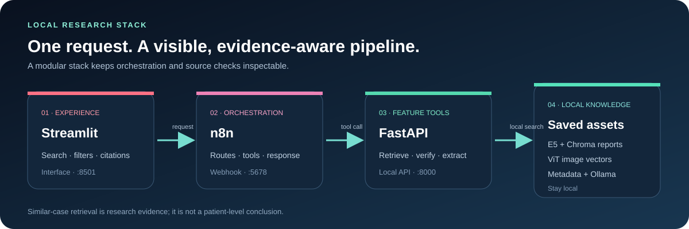
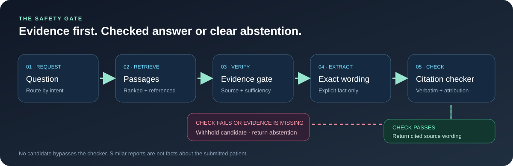

# BCMID · Local Evidence Assistant
### A research interface for breast imaging records, with sources in view

<b>Search reports · Explore similar training images · Verify every answer</b>

BCMID combines a Streamlit interface, n8n orchestration, FastAPI feature tools, E5/Chroma report retrieval, saved ViT image vectors, a metadata catalog, and local Ollama support.

> **Research demo only.** Similar cases are not facts about the person whose image or question was submitted. This project does not diagnose, assign BI-RADS, or provide clinical recommendations.

## The answer path

For exact BI-RADS or follow-up questions, BCMID extracts only an explicit sentence from a validated report passage. The evidence checker validates quotation, attribution, and citation before release. If evidence is missing or validation fails, the candidate is withheld and the workflow abstains.

Similar-image search uses saved ViT features and is separate from the Kaggle CLIP experiment. Similarity is not diagnostic confidence.

## Project map

| Path | Role |
| --- | --- |
| app.py · n8n_client.py | Streamlit interface and webhook client |
| projet/agentic_local/api.py | FastAPI feature tools |
| projet/agentic_local/evidence.py | Evidence and answer validation |
| projet/agentic_local/tools.py | E5/Chroma, ViT, and metadata retrieval |
| projet/n8n/bcmid_workflow.n8n.json | Portable n8n workflow export |
| projet/n8n/workflow_code/ | Routing and safe-response helpers |
| notebooks/ | Modular RAG and local Ollama notebooks |

The session-memory workflow remains an unpublished prototype and is not part of the demo route.

## Run locally · Windows

Local data, indexes, and model assets must already be available. Startup does not download or rebuild them.

### 1 · FastAPI

~~~powershell
cd D:\5eme\advanced_deep_learning\projet\agentic_local
.\start_api.ps1
~~~

Open [API docs](http://127.0.0.1:8000/docs) or [health](http://127.0.0.1:8000/health). Set $env:BCMID_PYTHON before launch to select another existing Python environment.

### 2 · Ollama and n8n

Confirm the configured model is installed:

~~~powershell
ollama list
~~~

Start or confirm n8n:

~~~powershell
cd D:\5eme\advanced_deep_learning\projet\agentic_local
.\start_n8n_demo.ps1
~~~

Open [n8n](http://127.0.0.1:5678). The published demo webhook is POST /webhook/bcmid-agent. Confirm the intended workflow is active.

### 3 · Streamlit

From the repository root:

~~~powershell
py -m venv .venv
.\.venv\Scripts\Activate.ps1
python -m pip install -r requirements.txt
Copy-Item .env.example .env
.\start_ui.ps1
~~~

Open [the interface](http://127.0.0.1:8501). Set N8N_WEBHOOK_URL in local .env to:

~~~text
http://127.0.0.1:5678/webhook/bcmid-agent
~~~

Keep .env, execution exports, report text, images, and patient identifiers out of GitHub.

## Explore

| Mode | Retrieval | What comes back |
| --- | --- | --- |
| Reports | E5 + Chroma | Ranked passages with source references |
| Images | Saved ViT features | Similar training images and metadata |
| Image + reports | Both search paths | Distinct report and image evidence |
| Metadata | Local catalog | Filtered training-set records |
| Checked quotations | Explicit facts + checker | Cited source wording or abstention |

n8n owns request routing and response orchestration. FastAPI provides report, image/upload, metadata, evidence-check, and candidate-generation tools. The retired /agent/query endpoint returns HTTP 410.

## Verify

~~~powershell
.\.venv\Scripts\python.exe -m pytest test_n8n_client.py test_app.py -q
node projet\agentic_local\tests\test_workflow.cjs
~~~

Run API core checks in the prepared local Python environment:

~~~powershell
python -m pytest projet\agentic_local\tests\test_core.py -q
~~~

Check service health, open the n8n workflow, then submit a synthetic request through Streamlit. Review status, citations, checker decision, and tool trace. Abstention is expected if evidence is missing or fails validation.

Focused local API and Streamlit checks passed. A synthetic checked-quotation request returned a cited answer accepted by the checker. These are engineering checks, not a clinical accuracy study.

## Assets and responsible use

Configure local BCMID data, Chroma reports, image vectors, metadata, model cache, and Ollama through projet/agentic_local/config.py. Large datasets, reports, model weights, vector databases, and execution outputs are intentionally excluded from this public repository.

Use retrieved evidence for research exploration only. Similarity does not show that two cases belong to the same patient or examination.
