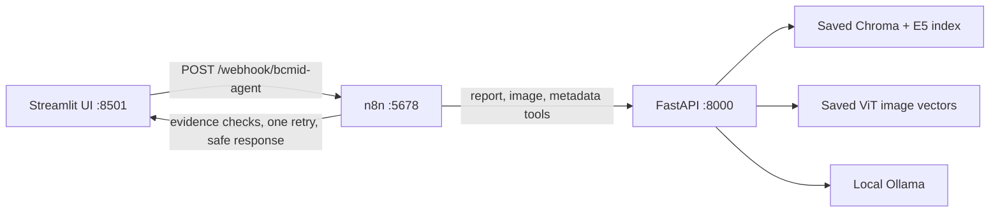

# BCMID Local Research Assistant

A local research application for exploring BCMID report passages and similar training images. The project combines a Streamlit interface, a FastAPI tool service, an n8n workflow, a local Chroma/E5 report index, saved ViT image vectors, and local Ollama generation with an evidence checker.

This is a research/demo system. Similar cases and report wording are retrieval evidence; the app does not diagnose a patient or assign a new BI-RADS category.

## How the services fit together



The UI sends requests to n8n. n8n selects the retrieval route, calls the local tool API, checks whether evidence is sufficient, optionally asks Ollama for exact quotations, validates the answer against its cited passages, allows at most one targeted retry, and returns the final status.

## Main project files

- `app.py`, `n8n_client.py`: Streamlit interface and its webhook client.
- `projet/agentic_local/api.py`: FastAPI endpoints used by n8n.
- `projet/agentic_local/tools.py`: report, image, and metadata retrieval over local indexes.
- `projet/agentic_local/evidence.py`: evidence sufficiency and exact-answer checks.
- `projet/agentic_local/start_api.ps1`: starts the API on port 8000 with the prepared Python runner when available.
- `projet/agentic_local/start_n8n_demo.ps1`: starts or detects the normal n8n profile on port 5678.
- `projet/n8n/bcmid_workflow.n8n.json`: portable workflow export for the current orchestration.
- `projet/n8n/workflow_code/`: JavaScript source for workflow routing, retrieval assembly, retries, and response handling.
- `notebooks/`: the cleaned source version of the modular Kaggle RAG notebook plus the local Ollama workflow notebook. The updated `modulaire-rag-bcmid-24.ipynb` is included with cell outputs removed.
- `projet/UI_WORKFLOW_TEST_GUIDE.md`: detailed manual UI and workflow test scenarios.

Large datasets, trained model files, Chroma databases, embeddings, and run outputs are intentionally kept out of GitHub. The application needs those local assets configured before retrieval can run.

## Start the application on Windows

Run each service in a separate PowerShell window from the project folder.

### 1. Start the local tool API

```powershell
cd D:\5eme\advanced_deep_learning\projet\agentic_local
.\start_api.ps1
```

The API listens on `http://127.0.0.1:8000`. Open its interactive docs at [http://127.0.0.1:8000/docs](http://127.0.0.1:8000/docs). Check `GET /health` for the saved index/model status.

The API requires the dependencies in `projet/agentic_local/requirements.txt`. The launcher looks for the prepared runner at `%TEMP%\bcmid-notebook-runner\Scripts\python.exe`; set `$env:BCMID_PYTHON` to another prepared Python executable if needed. It does not download models at startup.

### 2. Start or confirm n8n

```powershell
cd D:\5eme\advanced_deep_learning\projet\agentic_local
.\start_n8n_demo.ps1
```

n8n runs at `http://127.0.0.1:5678`. The expected published workflow is `BCMID local tools — visible orchestration`, ID `bcmidLocalToolsDemo`, with production webhook `POST /webhook/bcmid-agent`. Confirm the workflow is active/published in the n8n UI.

### 3. Start Streamlit

Create and install the UI environment once, from the project root:

```powershell
cd D:\5eme\advanced_deep_learning
py -m venv .venv
.\.venv\Scripts\Activate.ps1
python -m pip install -r requirements.txt
Copy-Item .env.example .env
```

Then start the UI:

```powershell
.\start_ui.ps1
```

Open [http://127.0.0.1:8501](http://127.0.0.1:8501). The `.env` file should point to the active local webhook:

```text
N8N_WEBHOOK_URL=http://127.0.0.1:5678/webhook/bcmid-agent
```

`.env` is local and must not be committed. `.env.example` is the safe template.

## Request paths and expected behavior

The Streamlit interface offers four modes:

| Mode | Tools | Typical result |
| --- | --- | --- |
| Reports | E5 + Chroma report search | Ranked report passages with source references |
| Images | Saved ViT-vector search | Similar training images and similarity scores |
| Image + reports | Report and image retrieval in parallel | Both evidence types; report links are patient-level, not guaranteed exam-level |
| Metadata | Local metadata catalog | Matching training-set rows and filters |

For Reports and Image + reports, **Return source passages** sets retrieval-only mode. **Checked quotations** enables generation only when the question asks about explicit follow-up or BI-RADS wording and the evidence checker finds sufficient passages.

The API asks the configured local Ollama model (`qwen2.5-coder:7b` by default) to return exact excerpts with evidence aliases. The answer checker verifies quotations, citations, patient attribution, and explicit facts. It releases an answer only after checks pass. Otherwise, the workflow returns `abstained`; the single retry is bounded to one attempt.

Image similarity is not diagnostic confidence. The image backend uses cached ViT vectors and is separate from the Kaggle CLIP experiment. Kaggle validation or pilot scores do not validate the local image backend or establish clinical accuracy.

## FastAPI endpoints

The base URL is `http://127.0.0.1:8000`.

| Method | Path | Purpose |
| --- | --- | --- |
| GET | `/health` | API, saved index/model, and Ollama availability |
| POST | `/tools/report-search` | Search report passages |
| POST | `/tools/image-search` | Search images supplied as base64 JSON |
| POST | `/tools/image-upload` | Multipart image upload route |
| POST | `/tools/metadata` | Search the local metadata catalog |
| POST | `/tools/evidence-check` | Check evidence sufficiency or answer evidence |
| POST | `/tools/generate` | Request checked-quotation candidate text from Ollama |
| POST | `/tools/report-jobs` | Start a report retrieval job for parallel orchestration |
| POST | `/tools/image-jobs` | Start an image retrieval job for parallel orchestration |
| POST | `/tools/jobs/collect` | Collect paired image/report results |

`POST /agent/query` is retired and returns HTTP 410. n8n owns planning and orchestration.

## Data, indexes, and startup requirements

The tool API expects local assets in the paths defined in `projet/agentic_local/config.py`:

- BCMID files under `projet/bcmid/BCMID_extracted/`.
- The report Chroma collection under `projet/agentic_local/artifacts/chroma_db/`.
- Saved image vectors and metadata under `projet/agentic_local/artifacts/embeddings_vit_clinicalbert_v1/`.
- The metadata catalog under `projet/agentic_local/artifacts/feature_metadata_lookup_v1/`.
- Cached E5 and ViT model weights under `projet/rag/outputs/hf_cache/`.
- A running local Ollama service with the configured model available.

These data/index/model assets are not downloaded or rebuilt by the app at startup. Restore or build them locally before testing retrieval. Keep raw reports, images, model weights, indexes, `.env`, and n8n execution output out of the public repository.

## Testing and run inspection

Run the existing UI/client checks from the root:

```powershell
.\.venv\Scripts\python.exe -m pytest test_n8n_client.py test_app.py -q
```

Run workflow routing checks:

```powershell
node projet\agentic_local\tests\test_workflow.cjs
```

Check services before UI tests:

1. Visit `http://127.0.0.1:8000/health`; confirm the saved report index, ViT assets, and Ollama model are available.
2. Visit `http://127.0.0.1:8000/docs` to inspect or call a tool endpoint.
3. Visit `http://127.0.0.1:5678/workflow/bcmidLocalToolsDemo`; confirm the workflow is published.
4. Submit one request per UI mode and inspect the response status, `tools_called`, `trace`, errors, and citations.
5. For Checked quotations, expect either `answered` with accepted citations or `abstained` when any quote/fact fails its evidence check.

Successful n8n execution history can store request bodies, including base64 images and retrieved report text. The local workflow may retain successful executions for debugging; review its execution-save settings before using sensitive data. Do not commit execution exports or result JSON files.

## Current verification note

The latest saved report-only checked-quotation run called retrieval, Ollama, and the answer checker, then safely abstained after the candidate failed exact-source checks. Generation and checking therefore ran; an abstention is not a passing generated answer. Run-specific excerpts and patient codes are kept in the local verification folder and are not part of this public source repository.
