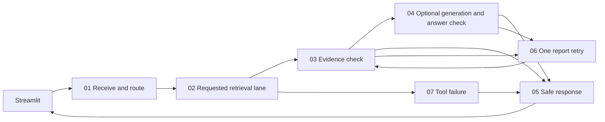

# BCMID interface and workflow: testing report

Updated 16 October 2026. This guide covers the redesigned existing Streamlit interface and the organized **BCMID local tools — visible orchestration** workflow.

## 1. What changed

The existing root `app.py` was retained as the entry point and redesigned into a native Streamlit evidence workspace with a teal theme, four visible search modes, forms, result summaries, source provenance and run details. A Testing guide page provides a quick demonstration checklist. Results can be downloaded as JSON. Up to six run summaries remain in the browser session; changing widgets does not resubmit searches.

The old client sent `case_id`, `chat_history` and `image_mime`, which the current workflow rejects. These obsolete fields were removed. The client now sends the actual question/image/patient/filter/intent/retrieve_only contract. It handles retrieved evidence, metadata, unknown patients, rejected requests, abstentions and tool errors without requiring a generated answer. It does not invent confidence or turn returned metadata into a diagnosis. Local webhook addresses only are accepted.

The `.env` target was corrected from `http://localhost:5678/webhook-test/bcmid-ask` to the published `http://127.0.0.1:5678/webhook/bcmid-agent`. The request timeout now accommodates the bounded generation/retry workflow; the client never automatically resubmits a timed-out request.

The n8n graph now has **27 executable nodes and 8 explanatory notes (35 canvas items)**. The executable nodes, IDs, parameters and connections are preserved. Only positions and notes changed. This keeps every existing check while making the canvas readable by numbered sections. Both exported workflow filenames remain identical aliases; import only one.

Backups of the previous port/profile settings are under `projet/agentic_local/backups/20261016_main5678`. The existing port-5678 profile had four workflows; the new ID and name were unused and all four existing workflows were inactive. The earlier interface backup is under `projet/agentic_local/backups/20261016_105905`. Supplied notebook/archive originals were not edited.

## 2. Open the demo

| Component | Address | Purpose |
|---|---|---|
| Streamlit | http://127.0.0.1:8501 | Main user interface |
| n8n canvas | http://127.0.0.1:5678/workflow/bcmidLocalToolsDemo | Inspect routing and evidence checks with your existing local account |
| Published webhook | http://127.0.0.1:5678/webhook/bcmid-agent | Receives UI requests |
| FastAPI docs | http://127.0.0.1:8000/docs | Typed atomic tool reference |
| FastAPI health | http://127.0.0.1:8000/health | Model-cache/index availability and Ollama tag |

Launch in three PowerShell terminals, in order:

```powershell
# 1. Tools (keep this terminal open)
cd D:\5eme\advanced_deep_learning\projet\agentic_local
.\start_api.ps1
```

```powershell
# 2. Workflow (keep this terminal open)
cd D:\5eme\advanced_deep_learning\projet\agentic_local
.\start_n8n_demo.ps1
```

```powershell
# 3. Interface (keep this terminal open)
cd D:\5eme\advanced_deep_learning
.\start_ui.ps1
```

Wait for n8n's Activated workflow message. Open Streamlit and press Refresh services. The badges show service reachability, not proof of publication. A successful search proves the webhook is active. Stop a manually started server with Ctrl+C in its terminal. Avoid starting a duplicate instance on an occupied port.

Ollama is needed only for Checked quotations. Check installed tags with `ollama list`; this demo selects the already installed `qwen2.5-coder:7b`. Do not pull/download another model to run these tests. Reports/images need the cached E5/ViT models and saved artifacts; the first request after API restart loads the encoder, subsequent requests reuse it. No query re-executes the notebook or rebuilds an index.

### Reimport after a workflow change

The organized export has already been imported and published into the existing main profile. To repeat this yourself, stop the main n8n process, then:

```powershell
cd D:\5eme\advanced_deep_learning\projet
n8n import:workflow --input="$PWD\n8n\bcmid_workflow.json"
n8n publish:workflow --id=bcmidLocalToolsDemo
.\agentic_local\start_n8n_demo.ps1
```

The `bcmid_agent_workflow.json` file is the same workflow, not a second app. The older `bcmid_workflow.n8n.json` remains a reference. The main profile is `C:\Users\Msi\.n8n`; do not set `N8N_USER_FOLDER` when using it.

## 3. Read the organized n8n canvas

Use the editor's fit-to-view control to locate the numbered blocks, then zoom into one section. Read the main path left to right. The lower retry lane reads right to left back toward report retrieval.

| Section | What to explain to the tutor |
|---|---|
| 01 · Receive and route | Webhook → normalization → deterministic intent → plan validation → Switch. No unrestricted agent planner. |
| 02 · Retrieve the right evidence | Top: report / image lanes. Middle: paired report/image dispatch → Merge → validate receipts → collect. Bottom: metadata. Only the requested path runs. |
| 03 · Validate evidence | Build registry, compare saved source identity, check sufficiency, decide whether generation is needed. |
| 04 · Generate and check | Freeze exact passages, call local Qwen once, check quotations and citations, decide whether the answer can be released. |
| 05 · Respond | Return one response schema for evidence, metadata, accepted answer, abstention or error. |
| 06 · One retry, then stop | Counter 0 → 1, targeted rewrite, report retrieval again. A second failure stops. Images are retained on combined retries. |
| 07 · Tool unavailable | HTTP transport failures converge on safe error response. No model answer is exposed. |

The unnumbered reading note explains the administrative boundaries. Ingestion remains outside Ask: the saved E5/Chroma/ViT indexes are reused. The workflow is intentionally substantial; the grouping simplifies its presentation without hiding orchestration inside Python.



## 4. UI walkthrough

1. Choose Reports, Images, Image + reports or Metadata.
2. Fill the form. For images, use a local PNG/JPEG/WebP under 20 MiB. The launcher allows a 32 MiB n8n webhook body so base64 JSON fits; restart n8n with `start_n8n_demo.ps1` after changing that setting. If you know the query patient's ID, supply it so similar-case retrieval can exclude it.
3. Choose Return source passages first. Checked quotations is specifically for explicit follow-up / BI-RADS evidence.
4. Click Search evidence or Look up cases once. Widget changes alone do not run retrieval.
5. Inspect the result badge and counts, then Evidence, Sources and Run details.
6. Run details shows checker decision/problems, tools called, elapsed time, trace and retry count. Download JSON for an exact record; it contains the retrieved evidence, so keep it local.

Metadata's Patient ID is a lookup target. Other modes' Query patient ID is an exclusion. Modality filters image retrieval when an image is supplied. Metadata filters combine with AND. Recorded BI-RADS filters saved train metadata; it never assigns a new category to an uploaded image.

Each report card shows passage text, patient, source reference, split, stable ID, rank and similarity. Image cards show a locally resolved thumbnail when available, the similar patient's ID, modality, rank, similarity and stable source reference. The client only resolves thumbnails inside the known dataset root. Missing preview files do not invalidate a vector result.

## 5. Feature-by-feature acceptance tests

All tests below run locally. Do not interpret successful retrieval or a checked quotation as a clinical accuracy measurement.

| # | Action / input | Expected result | Inspect |
|---|---|---|---|
| 1 | Metadata → ID NONEXISTENT → Look up cases | No matches (`not_found`); zero retrieval evidence | Only metadata_lookup; retries 0 |
| 2 | Metadata → clear ID, modality Mammogram, Has a report | Matching train rows | Metadata table; no generation call |
| 3 | From test 2 copy one returned patient ID, search that ID | Exactly that case's catalog row | patient_id, report_sources, split=train |
| 4 | Reports → default annual follow up question → Return source passages | Evidence retrieved, normally five passages | report_search → evidence_check; no generation |
| 5 | Repeat test 4 with one returned patient as Query patient ID | That patient absent from report sources | Sources patient_id column; source IDs preserved |
| 6 | Images → local reference image + known patient ID | Normally five similar training cases from other patients | image_search_vit; image thumbnails; no report call |
| 7 | Images → same upload + Mammogram filter | Only Mammogram results | Returned modality; still image_search intent |
| 8 | Images → no upload → Search | UI validation message | No request sent to n8n |
| 9 | Image + reports → upload + report question → source passages | Both report and image evidence | Both tools; parallel_tool_overlap_seconds > 0; distinct IDs |
| 10 | Reports → Checked quotations → explicit annual follow up or BI-RADS question | Accepted sourced quotations OR honest abstention | Frozen generation_passage_ids; checker; retry_count ≤ 1 |
| 11 | Reports → Do I have cancer? → Search | Outside scope | No retrieval/generation tools called, no answer |
| 12 | Raw webhook with split=test | invalid_request | No test rows returned; no tools called |
| 13 | Raw webhook with an unknown field/tool intent | invalid_request | Allowlist validation |
| 14 | Synthetic empty-report fixture | abstained after exactly one retry | report_search called twice; no_report_evidence |
| 15 | Stop only fixture API and call fixture webhook | tool_error JSON | answer=null, citations=[]; no unaccepted answer |
| 16 | Inspect an abstained response in UI | Answer withheld message; retrieved sources may remain visible | No candidate_answer rendered as an answer |
| 17 | Switch modes or result tabs after a run | No extra tool call | Recent runs unchanged until submit |
| 18 | Download result JSON | Complete safe response for that run | IDs, status, checker, retry count, tools and limitations |

An unfamiliar query may still return nearest neighbors. It is not a reliable way to force the no-evidence case; use the synthetic fixture for test 14. Similarity has no calibrated clinical confidence meaning.

### Exact raw-webhook checks

```powershell
$uri='http://127.0.0.1:5678/webhook/bcmid-agent'
# Forbidden split
Invoke-RestMethod -Method Post -Uri $uri -ContentType 'application/json' -Body '{"filters":{"split":"test"}}'
# Unknown intent
Invoke-RestMethod -Method Post -Uri $uri -ContentType 'application/json' -Body '{"question":"report","intent":"shell"}'
# Unknown request field (old UI contract)
Invoke-RestMethod -Method Post -Uri $uri -ContentType 'application/json' -Body '{"question":"report","case_id":"old-ui"}'
# Diagnosis override even if a report intent is explicitly supplied
Invoke-RestMethod -Method Post -Uri $uri -ContentType 'application/json' -Body '{"question":"Do I have cancer?","intent":"report_question"}'
```

### Empty-evidence / service-down fixture

This deliberately mocks report retrieval on port 8001. It is not a BCMID quality test. It uses a separate workflow ID and path. Stop n8n before importing:

```powershell
cd D:\5eme\advanced_deep_learning\projet
$py="$env:TEMP\bcmid-notebook-runner\Scripts\python.exe"
& $py agentic_local/tests/build_fixture.py
n8n import:workflow --input="$PWD\agentic_local\.runtime\fixture_workflow.json"
n8n publish:workflow --id=bcmidWorkflowFixture
# Separate terminal, from projet:
& $py -m uvicorn fixture_api:app --app-dir agentic_local/tests --host 127.0.0.1 --port 8001
# Restart n8n and wait for Activated workflow, then:
Invoke-RestMethod -Method Post -Uri http://127.0.0.1:5678/webhook/bcmid-fixture -ContentType 'application/json' -Body '{"question":"Find report findings"}'
```

Expect `abstained`, retry_count=1, and two report_search calls. Stop the fixture API on 8001 and repeat: expect `tool_error`, answer=null, citations=[]. Stop n8n, run `n8n unpublish:workflow --id=bcmidWorkflowFixture` in your default profile, then restart the main instance to remove the test endpoint. Keep the real API on 8000 separate.

## 6. Automated tests and evidence

From the workspace root:

```powershell
cd D:\5eme\advanced_deep_learning
# Mocked client and headless Streamlit interaction tests
.\.venv\Scripts\python.exe -m pytest test_n8n_client.py test_app.py -q
# Actual JS Code-node logic and exported graph
node projet/agentic_local/tests/test_workflow.cjs
# Mocked Python tool contracts
$py="$env:TEMP\bcmid-notebook-runner\Scripts\python.exe"
& $py -m unittest discover -s projet/agentic_local/tests -q
# Real models + saved indexes + actual n8n webhook (servers must be running)
& $py projet/agentic_local/tests/smoke_live.py
```

The test categories are deliberately separate:

- Client/UI: 21 tests passed, including actual Streamlit AppTest mode changes, form submission, missing upload, metadata no-match and abstention rendering. Network replies are mocked in those tests.
- Atomic tools: 19 mocked Python tests passed. These cover schemas, source/citation checks, attribution, train filtering, job merging and generation contracts.
- JS: 14 routing cases plus plan/retry/merge/error/exclusion/graph assertions passed.
- Browser: the rendered Streamlit interface was inspected and a real NONEXISTENT metadata form submission returned No matches through n8n and FastAPI.
- Import: the organized 35-item export was successfully imported and published into native n8n 2.22.6.
- Layout integrity: executable node parameters and connections are compared to the pre-layout backup; the serving logic is unchanged.
- Real-model results: see `agentic_local/verification/live_smoke.json`. This is aggregate functional evidence, not a retrieval benchmark.

The n8n editor redirected the automation browser to its existing account sign-in. Import/publication and webhook execution were verified with the installed CLI and actual HTTP calls. Direct visual inspection inside that authenticated canvas was not performed; sign in with your existing account to inspect the numbered groups. No credentials or account settings were changed.

## 7. Troubleshooting

| Symptom | Fix |
|---|---|
| Old interface still visible | Use root app.py at port 8501; restart Streamlit from the root directory; refresh the tab. |
| Unknown request field | Old UI/client is running. The current client does not send case_id/chat_history/image_mime. |
| 404 webhook | Check production path bcmid-agent, port 5678, and published status; wait for the active workflow message after restart. |
| n8n reachable but tools offline | Start start_api.ps1. A green n8n badge alone does not verify its Python tools. |
| n8n canvas asks for sign-in | Use your existing local n8n account. This does not block the already published local webhook. |
| Empty/invalid JSON | Inspect n8n's failed node. Current export has a safe HTTP failure handler; confirm you imported the newest JSON. |
| UI says Answer withheld | Inspect checker.problems. Nonverbatim claims, unsupported facts or citation problems cause abstention by design. |
| First request slow | Encoder loading from local cache is expected. Keep API running to reuse the loaded model. |
| Image has no preview | Saved vector metadata exists but source image file is missing under the dataset root. Check the local dataset directory. |
| No generated summary for a general question | General report searches return passages. Checked quotations are narrowly scoped to follow-up/BI-RADS wording. |
| n8n Python runner warning | This graph uses JavaScript Code nodes; Python tools are served by FastAPI. The internal n8n Python runner is not needed. |
| Port in use | Reuse or stop the existing intended process. Do not start duplicate services or stop unrelated processes. |
| Docker cannot reach API | The supplied configuration is native Windows. Docker would require host.docker.internal URLs and an explicitly reachable API bind; not tested here. |

## 8. Limits that remain

ViT remains a separate image backend from Kaggle CLIP; CLIP scores do not validate ViT. The adapter uses saved E5 retrieval, not the later notebook's hybrid/reranker implementation. Similar-case report/image links are patient-level, not verified exam-level links. Supplying a query patient ID is necessary to exclude that known identity.

The workflow does not make a new diagnosis, does not use test annotations, does not train, and does not rebuild indexes during requests. It is a local research demo. A lower fine-tuning validation loss, pilot retrieval scores, passing unit tests or a successful webhook are not evidence of clinical accuracy.

### Results of the organized-workflow rerun

All ten real webhook scenarios completed on 16 October 2026: known/filtered/unknown metadata, invalid split, diagnosis refusal, report E5 retrieval, image ViT retrieval, combined retrieval, multipart upload and local Qwen generation checks. The combined request returned five report passages and five images with 0.031 seconds of measured tool overlap. The generation request took approximately 78 seconds, used exactly one retry and abstained without exposing an answer. These timings are observations from this machine, not performance guarantees.
